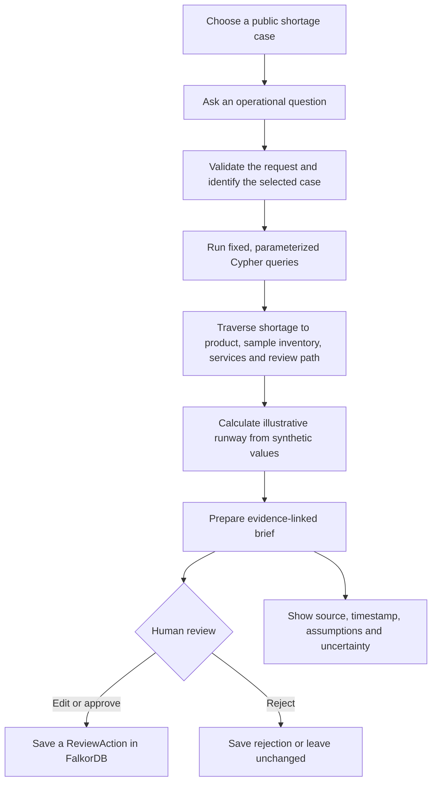
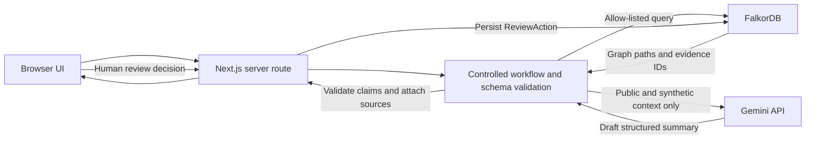
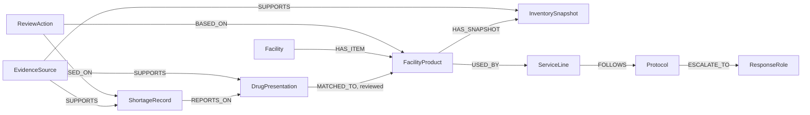

# ShortageBridge — Hackathon Project Plan

**Purpose:** A step-by-step, beginner-friendly plan for building a FalkorDB-powered hospital drug-shortage impact and coordination prototype for the WeMakeDevs Graph Hacks hackathon.

**Status:** Planning document only. It contains no coding prompts, and no project code has been created.

**Research checked:** October 12, 2026. Recheck event rules, model availability, free-tier limits, package versions, and live data on the day you start.

---

## 1. The idea in one minute

### Working name

**ShortageBridge — Hospital Shortage Impact & Coordination Agent**

### Who it helps

A hospital pharmacy operations lead who has heard that a drug product is in shortage and needs to understand which hospital services and internal response roles might need to review it.

### What it does

The user asks a focused question such as: **“What could this shortage affect at our sample hospital, and what should the pharmacy team review?”** The app traces a path through a graph that connects a public shortage record to a matching drug presentation, a clearly synthetic hospital item and inventory snapshot, the services that use the item, and the sample response protocol and role.

It calculates an illustrative stock-runway estimate from synthetic data, shows the data sources and assumptions behind each result, and prepares a review brief for a human pharmacist. A person decides what to do.

### What it does not do

- It does not recommend a substitute medication, make a clinical decision, prescribe, ration, or place an order.
- It does not claim FDA shortage data tells us whether a particular hospital or wholesaler has stock.
- It does not use real patient records or private hospital inventory.
- It is a hackathon prototype for operational exploration, not a clinical product.

### Why the problem is worth showing

ASHP’s 2024 survey of 400 respondents found that nearly 85% reported moderate or critical operational impact from IV-fluid shortages; critical impacts included treatment delays or cancellations. This is evidence that shortages can affect hospital operations, not evidence that this prototype can predict clinical outcomes. [ASHP survey](https://news.ashp.org/news/ashp-news/2024/11/08/new-ashp-survey-shows-how-hospitals-are-handling-iv-fluid-shortages)

Shortage and pharmacy-supply products already exist, so do not claim that the broad category is new. For example, SureCost describes pharmacy supply and procurement capabilities. The project’s intended distinction is a visible, source-traced **operational impact path and human-review handoff**, rather than a general procurement or shortage-alert dashboard. [SureCost](https://www.surecost.com/)

---

## 2. Hackathon fit and rules to build around

The event page describes **Graph Hacks: Context for AI Agents**, running online **October 15–18, 2026 (IST)**. The relevant category is **Track 01: Agents That Act on Connected Data**, whose stated focus includes multi-hop reasoning, graph queries or algorithms as agent tools, MCP, actions based on graph context, and explainability. The listed prize for this track is an **iPhone 18 Pro**. Confirm the live event page before relying on dates, prize terms, or current rules. [Hackathon page](https://www.wemakedevs.org/hackathons/falkordb)

The rules say FalkorDB must be central to the project and do real work. A graph that is only a decorative picture is not enough. The rules also describe limits on when coding/design work may begin, acceptable data, and submission expectations. Before kickoff, stay within the permitted preparation activities: notes, research, a graph model, and diagrams. Do not start implementation or polished product design before the event start if the rules prohibit it. [Official rules](https://www.wemakedevs.org/hackathons/falkordb/rules)

### Submission requirements to confirm on kickoff day

- Select the track that best fits the finished project; this plan targets Track 01.
- Make the repository public if required by the submission rules.
- Include a README with setup steps, graph model, and important Cypher queries or algorithms.
- Provide the required demo video and either a live deployment or clear local setup instructions.
- Disclose AI coding assistance as required and be prepared to explain the design yourself.
- Check exact deadline, team limits, judging criteria, permitted pre-event activity, and any new rules on the official page. The current plan assumes a submission deadline of **October 18 at 11:59 PM IST**, which must be verified at kickoff.

---

## 3. Research findings and data plan

### Public shortage data: openFDA

The openFDA Drug Shortages API is the best MVP starting point for public shortage facts. Its official documentation describes daily updates and data coverage beginning in 2012. Depending on the record, fields include product identifiers such as package NDC, generic and proprietary names, company name, presentation, availability, shortage reason, dosage form, strength, status, initial posting date, update date, and related information. [openFDA Drug Shortages API](https://open.fda.gov/apis/drug/drugshortages/) · [Searchable fields](https://open.fda.gov/apis/drug/drugshortages/searchable-fields/)

Example endpoint to investigate at kickoff: `https://api.fda.gov/drug/shortages.json`. Use the current API documentation for query syntax and limits; do not assume every field is present or that identifiers are harmonized perfectly across datasets. Save the retrieval timestamp and source URL with each import. Treat the data shown in the demo as a timestamped snapshot, because records can change. If using bulk downloads, follow openFDA’s guidance to refresh the full dataset rather than assuming old records never change. [openFDA downloads](https://open.fda.gov/data/downloads/)

**Important limit:** FDA says manufacturers provide much of the shortage information and that a listing means FDA is aware of the shortage and is working with manufacturers. It is not a live inventory feed for a local hospital, pharmacy, or wholesaler. [FDA Drug Shortages](https://www.fda.gov/drug-shortages)

openFDA warns that its data is not intended to make medical decisions. This prototype must keep that limitation visible. [openFDA API documentation](https://open.fda.gov/apis/drug/drugshortages/)

### Synthetic hospital data: needed to show the useful graph paths

Public shortage records do not provide a particular hospital’s inventory, daily consumption, service-line use, local protocol, or distributor stock. Make a small, fictional hospital dataset for the demo and label every such record **“synthetic demo data.”**

Create a few fictional services (for example, Emergency Department, ICU, and Operating Room), a handful of sample formulary items, synthetic inventory snapshots, illustrative average daily use, and a small set of internal review roles/protocols. Pick one public shortage record and create an explicit, manually reviewed link to a demo product presentation only when the identifiers and product details support that link. Record who/what established the match and how certain it is. If the match is uncertain, show it as uncertain or leave it unmatched.

Do not invent a manufacturer-to-distributor-to-hospital supply chain from the FDA’s company field. A manufacturer named on a public record is not proof of local supplier availability.

### Optional source: FDA Orange Book

The FDA Orange Book provides approved drug product and therapeutic-equivalence information. Its equivalence ratings concern specific approved products; they are not a general clinical-substitution engine for a different therapeutic agent. Do not use the Orange Book to recommend a clinical substitute in this project. It is optional for a carefully labeled reference about an exact product/generic relationship, and is not needed for the MVP. [Orange Book data files](https://www.fda.gov/drugs/drug-approvals-and-databases/orange-book-data-files) · [Orange Book preface](https://www.fda.gov/drugs/development-approval-process-drugs/orange-book-preface)

### Data handling rules

- Use public sources and synthetic hospital data only.
- Do not include patient data, real hospital inventory, credentials, or confidential information.
- Do not use ASHP material as an application dataset unless you have verified permission. Use the survey only as cited problem evidence.
- Store provenance on every imported or synthetic fact: source, retrieval time, data origin, and relevant record identifier.
- Show the “as of” time on the UI and in generated summaries.
- State assumptions in plain language; never present synthetic data as real hospital facts.

---

## 4. Product behavior and user journey

### One focused demo scenario

1. A user opens a known shortage case sourced from openFDA.
2. The user asks which sample hospital services may be affected and what the pharmacy team should review.
3. The server looks up the shortage and the manually linked product presentation.
4. FalkorDB follows the connected path to the fictional facility item, inventory snapshot, service lines, and review protocol/role.
5. The application calculates `estimated runway days = synthetic on-hand quantity ÷ synthetic average daily use` and labels the estimate as illustrative.
6. An LLM turns the retrieved facts into a concise, structured brief. Each claim must point to evidence IDs or be labeled as a synthetic assumption.
7. The user sees the graph path, source links, timestamps, uncertainty, and assumptions, then edits/approves/rejects a review action.
8. The human-reviewed action is stored in FalkorDB as a demo record. It does not change a real protocol, inventory, or order.

### User flow

### Architecture flow

The model never gets a direct database connection and never runs its own Cypher. The application owns each query and executes it only after validating its inputs.

---

## 5. Graph model for FalkorDB

Use the graph to express why a shortage could matter to a specific demo workflow and to return the connected evidence. The path is the central product behavior.

### Suggested node types

| Node | What it represents | Data origin |
|---|---|---|
| `ShortageRecord` | One public shortage listing and its status/dates | openFDA; retain source ID, URL, and `as_of` |
| `DrugPresentation` | A specific product presentation, strength, dosage form, and identifiers | Public record plus reviewed normalization |
| `Facility` | The fictional demo hospital | Synthetic |
| `FacilityProduct` | A fictional formulary/product entry at the facility | Synthetic |
| `InventorySnapshot` | On-hand quantity at a stated demo time | Synthetic; never imply live inventory |
| `ServiceLine` | A fictional service that uses the demo product | Synthetic |
| `Protocol` | A fictional internal review/escalation procedure | Synthetic and labeled as an example |
| `ResponseRole` | A fictional team role, such as “pharmacy operations lead” | Synthetic; no real people |
| `EvidenceSource` | Source metadata or a synthetic-data declaration | Public source or explicit synthetic label |
| `ReviewAction` | The human’s demo review outcome and timestamp | User-entered demo action |

### Suggested relationships

Store public and synthetic provenance as properties or linked evidence nodes. Use a clear `data_origin` property such as `openfda`, `synthetic_demo`, or `reviewed_mapping`. Keep a match status such as `exact`, `reviewed`, or `uncertain`; never silently equate products based only on similar names.

### Useful fixed queries

Prepare and document a small set of named Cypher queries. The exact syntax should be checked against the current FalkorDB and client documentation at kickoff.

1. **Shortage search:** Find shortage records by a normalized product identifier or name.
2. **Shortage details:** Return status, dates, availability, reason (when present), source URL, and `as_of` timestamp.
3. **Impact path:** Traverse the selected shortage to the reviewed product match, sample facility item, latest sample inventory snapshot, service lines, protocol, and response role.
4. **Evidence path:** Return source identifiers and provenance for each fact used in the brief.
5. **Human action:** Save an approve/edit/reject record with timestamp and links to the selected graph entities.

Create useful indexes on identifiers used for lookups after confirming syntax with FalkorDB’s docs. Use query parameters rather than building query strings from user input. Use FalkorDB explain tooling when useful to inspect the query plan. [FalkorDB range indexes](https://falkordb.github.io/docs-staging/cypher/indexing/range-index/)

### How to prove FalkorDB is essential

In the demo, show the exact multi-hop path and one meaningful change: for example, change a synthetic inventory snapshot or service-use relationship and show that the returned affected services or illustrative runway changes. The output should be derived from graph query results, not a prewritten story. Keep the data synthetic and the assumptions visible.

---

## 6. Recommended technology stack

### Recommendation: one-language TypeScript application

Use **TypeScript end-to-end** for the MVP. This reduces the number of languages and services you need to learn during a four-day hackathon. Current official FalkorDB TypeScript client documentation and Google’s JavaScript SDK make this practical. Verify current package versions at kickoff.

| Part | Choice | Why it fits |
|---|---|---|
| App and server | Next.js App Router with TypeScript | One app can serve the UI and server endpoints. Keep FalkorDB access in server-side route handlers. Use the Node.js runtime for the database client. |
| Graph database | FalkorDB, local Docker for development | Required graph technology; stores shortage/product/facility/evidence/action connections and answers multi-hop impact queries. |
| FalkorDB client | Official `falkordb` TypeScript package | The official TS client supports connecting, selecting a graph, and running parameterized queries. Do not start from the old `node-falkordb` package; its repository says it was replaced. |
| LLM | Google Gemini API, current free-tier model confirmed at kickoff | Structured summaries and tool/function-call requests; use only public and synthetic information. The model is replaceable behind one small server module. |
| LLM SDK | Official `@google/genai` JavaScript SDK | Keeps model calls in TypeScript and supports function calling. |
| Input/output checks | Zod | Checks user inputs and model-produced structured output before use. |
| UI | React components in Next.js | Present shortage facts, evidence paths, assumptions, and the human review step. |
| Local setup | Docker Compose for FalkorDB + Next.js app | Reproducible local demo. Add public hosting only if time remains and secrets are protected. |
| Graph visualization | Optional React Flow or Cytoscape | Add only after the actual query path is working; a clear list/path panel is enough for the MVP. |

FalkorDB’s current TypeScript client uses a `FalkorDB` connection, graph selection, and query methods; use the current client guide rather than copying from older examples. [FalkorDB TypeScript client](https://www.npmjs.com/package/falkordb) · [Getting started](https://falkordb.github.io/docs-staging/getting-started/) · [FalkorDB client repository](https://github.com/FalkorDB/falkordb-ts)

Next.js documents its App Router and route-handler approach here: [Next.js App Router](https://nextjs.org/docs/app). Keep database and model credentials on the server. Do not deploy FalkorDB client calls into browser code or an Edge runtime unless the current client explicitly supports it.

### LLM choice: Gemini by default; do not assume Grok API is free

As checked on October 12, 2026, Google’s Gemini API pricing page lists a free tier for the documented `gemini-3.8-flash` model. Free-tier quotas are subject to change and vary by model/account, so confirm exact limits in AI Studio immediately before building. [Gemini pricing](https://ai.google.dev/gemini-api/docs/pricing) · [Model guide](https://ai.google.dev/gemini-api/docs/latest-model) · [Rate limits](https://ai.google.dev/gemini-api/docs/rate-limits)

Gemini function calling is a request/response pattern: the model can ask the app to call a declared function, but **your application executes the function** and returns its result. Declare only the few fixed functions in this plan, validate their arguments, and have your code run the Cypher. [Gemini function calling](https://ai.google.dev/gemini-api/docs/function-calling)

xAI’s developer API pricing is usage-based. Do not assume that a free consumer Grok account provides a free Grok API for your app. Use Grok only if you separately confirm a current API credit/free offer and its terms. [xAI API pricing](https://docs.x.ai/developers/pricing)

**Gemini free-tier privacy and use constraints:** Google’s terms describe additional data-use conditions for unpaid services, including possible human review of submitted content. Never send secrets, confidential information, real patient information, or real hospital operational data. The terms also restrict using the services in clinical practice or to provide medical advice. Keep this as a non-clinical hackathon prototype with synthetic hospital information and public records only; it is not for clinical deployment. Re-read the current terms before use. [Google AI terms](https://ai.google.dev/gemini-api/terms)

### Keep the first version small

- No vector database: the MVP’s facts are structured and connected, so Cypher traversal is the useful operation.
- No model-generated arbitrary Cypher: use fixed, parameterized queries.
- No agent framework unless a concrete need appears: a short, explicit workflow is easier to debug and explain.
- No separate Python service: a single TypeScript app avoids cross-language setup.
- No real-time vendor availability claim: it is not available from the selected source.
- No automatic alternative-drug suggestion or purchase/order action.

---

## 7. Build plan, from preparation to submission

### Before kickoff: research and planning only (October 12–14)

**Goal:** Be ready to build without crossing any pre-event restrictions.

1. Re-read the official event and rules pages. Write down permitted preparation and the exact kickoff/deadline in IST.
2. Keep this plan, the source list, the graph diagram, and a one-paragraph problem statement ready.
3. Select one public shortage case to investigate, but confirm it is still present and suitable after kickoff.
4. Draft a tiny fictional hospital scenario on paper: a few services, products, quantities, daily-use assumptions, and a review role. Label it synthetic.
5. Check that your team setup and account access work; do not create implementation or polished interface work early if prohibited.
6. At kickoff, recheck SDK/model versions, Gemini free quota, data freshness, and submission terms.

**Ready when:** You can explain the user, the problem, the graph path, the public data source, the synthetic-data boundary, and why FalkorDB is central in about one minute.

### Phase 1 — Kickoff and minimal working environment (October 15)

1. Confirm the rules and submission requirements one last time.
2. Create the repository and choose a public license if the rules/team require one.
3. Create a simple Next.js TypeScript app and local Docker Compose setup for FalkorDB, following current official docs.
4. Put secrets in a local environment file ignored by Git; add a safe example environment file with blank values.
5. From a server-side route or small server module, connect to FalkorDB, select a graph, create one test node, read it back, and delete/recreate seed data safely.
6. Commit the working setup and document how to start it.

**Verify before moving on:** The app starts locally, FalkorDB is reachable, a parameterized query returns a result, and no API key is in the browser bundle or Git history.

### Phase 2 — Import public records and seed synthetic data (October 15–16)

1. Fetch a small, useful slice from the documented openFDA endpoint, or use a clearly dated snapshot. Do not load an unnecessarily large dataset.
2. Normalize only the fields needed for the demo: source ID, product identifiers, name, presentation, strength/form when available, status, availability/reason when available, dates, source URL, and retrieval timestamp.
3. Handle missing/changed fields safely. Preserve the original values needed to inspect the record.
4. Seed the fictional facility, formulary items, inventory snapshots, use rates, service lines, protocols, and roles with explicit synthetic provenance.
5. Add one manually reviewed product mapping from a public shortage record to a synthetic item. Store the match status and why it was made.
6. Make seeding repeatable: running it again should update or reuse the same logical records rather than multiplying duplicates.

**Verify before moving on:** A person can inspect a record and tell what came from openFDA, what is synthetic, when the public record was fetched, and how a product match was made. An unmatched or uncertain product should not be shown as exact.

### Phase 3 — Build graph queries and prove multi-hop reasoning (October 16)

1. Implement the fixed shortage lookup query.
2. Implement the impact traversal through the reviewed match, sample facility item, inventory, service lines, protocol, and role.
3. Return evidence IDs, timestamps, and synthetic/public provenance alongside each result.
4. Add indexes for frequently queried identifiers after confirming support and syntax.
5. Use query parameters for all user-supplied values.
6. Keep an example query and the graph schema in the README.

**Verify before moving on:** Changing the graph’s synthetic relationships or quantity changes the returned impact path or runway estimate. Every displayed statement can be traced to a query result or is visibly labeled an assumption. This is the proof that FalkorDB is doing real work.

### Phase 4 — Add server endpoints (October 16)

Create a small number of server-side endpoints, for example:

- `GET /api/health` — report whether the app and graph database are available.
- `GET /api/shortages` — list a small set of imported public records.
- `GET /api/shortages/[id]` — return the selected record and provenance.
- `POST /api/impact` — validate a case ID/question, execute fixed queries, and return graph evidence plus deterministic calculations.
- `POST /api/review-actions` — validate and save a human’s review outcome.

Validate request and response shapes with Zod. Keep FalkorDB and Gemini calls in server modules. Return helpful errors when the database or model is unavailable; do not expose stack traces or secrets.

**Verify before moving on:** Invalid input is rejected, normal questions cannot alter Cypher structure, and browser requests cannot connect directly to FalkorDB.

### Phase 5 — Add the LLM as a constrained explainer (October 16–17)

1. Confirm the current free-tier model and limits. Use `gemini-3.8-flash` only if it remains available under the current terms and quota.
2. Keep one server-side model adapter so the provider can be changed without rewriting graph code.
3. Give the model only the user’s question plus the selected public/synthetic facts and evidence IDs. Do not send patient or confidential data.
4. Ask for a structured brief with fields such as: `summary`, `potentially_affected_services`, `review_checklist`, `assumptions`, `unknowns`, and `evidence_ids`.
5. If using function calls, expose only fixed functions such as `get_shortage_details(case_id)` and `get_impact_path(case_id)`. Validate arguments and have application code run them.
6. Validate the model response. Confirm each `evidence_id` came from the query result. If it invents a source, product match, or fact, discard that claim or show an error.
7. If quota/network/model fails, display the graph facts and a short deterministic template for the known demo case. The project should still work without the LLM.
8. State visibly that this is an operational prototype and is not medical advice or a clinical decision tool.

**Verify before moving on:** The model cannot generate or execute arbitrary Cypher, unsupported claims are removed or flagged, and the main demo works when the model call is unavailable.

### Phase 6 — Build the user interface (October 17)

Build in this order:

1. **Shortage list:** product name, status, source, and “data as of” time.
2. **Case view:** public shortage facts, missing information, and source link.
3. **Impact view:** a readable connected path from shortage to product, sample stock, service line, protocol, and role.
4. **Runway estimate:** show the formula, synthetic quantity, synthetic daily-use assumption, and result together.
5. **Evidence panel:** list public sources, synthetic records, retrieval time, match status, and uncertainties.
6. **Review brief:** show the LLM/deterministic summary and checklist; let the user edit, approve, or reject the proposed review action.
7. **Saved action:** show the human’s decision and timestamp, clearly labeled as a demo action.

Prioritize legibility and trust over animation. Add a graph visualization only if the query and evidence panels are already reliable. A simple path list can be clearer than a complicated graph canvas.

### Phase 7 — End-to-end review and presentation polish (October 17–18)

Walk the full demo from a clean start using only the README instructions. Check:

- Local database and app start in the documented order.
- The selected public source is still accessible and its snapshot timestamp is visible.
- Synthetic data is labeled everywhere it appears.
- The exact match, uncertain match, and no-match cases behave safely.
- Runway math is correct for the example values and says it is illustrative.
- Model output is validated and tied to returned evidence IDs.
- A missing API key, model outage, or quota limit still allows the deterministic demo path.
- No secrets or private information appear in the repository, logs, screenshots, or recording.
- The UI and narration do not imply FDA listing equals local stock or that this tool chooses clinical substitutes.

### Phase 8 — README, demo video, and submission (October 18)

Complete these before the deadline, leaving a time buffer:

1. Public repository visibility and a clean, understandable project name.
2. README: problem, intended user, what it does/does not do, architecture, graph schema, data sources and timestamps, synthetic-data statement, setup steps, environment variables, key Cypher queries, model use, limitations, and AI coding disclosure.
3. Required demo video. Show one complete case: source record → graph traversal → affected sample services → assumptions/evidence → human review → saved demo action.
4. Working local setup instructions, or a tested deployment if you have time and can protect all keys.
5. Submission form completed for the correct track, with repository and video links.
6. Verify the final submission receipt/status before the official deadline.

### Suggested four-day time budget

| Day | Main goal | Must-have result |
|---|---|---|
| Oct 15 | Setup and graph connection | Local app talks to FalkorDB; one parameterized query works |
| Oct 16 | Data, graph model, queries, server | Public + synthetic records; useful multi-hop impact query |
| Oct 17 | Constrained LLM and UI | Complete evidence-linked user journey, with deterministic fallback |
| Oct 18 | Fix, document, record, submit | README, video, public repo, submission receipt |

Do not spend the final day adding a second data source or a new framework unless the core flow is already complete.

---

## 8. Acceptance checklist

The project is ready to submit when all of these are true:

- [ ] The selected use case is concrete and the target user is clear.
- [ ] The official hackathon rules and deadline were rechecked.
- [ ] FalkorDB answers the multi-hop question and is central to the demo.
- [ ] Public FDA facts and synthetic hospital assumptions are visibly distinguishable.
- [ ] Every fact has a source or a synthetic label, plus a timestamp where relevant.
- [ ] The project does not claim that public shortage data proves local stock.
- [ ] The project does not recommend a therapeutic substitute or make a medical decision.
- [ ] All graph queries are fixed and parameterized; the LLM cannot run arbitrary Cypher.
- [ ] The model output is checked and points to returned evidence IDs.
- [ ] A deterministic fallback allows the demo to work if the free model quota is exhausted.
- [ ] No patient/private data or secret keys are included.
- [ ] Setup, graph schema, queries, data sources, limitations, demo video, and AI disclosure are documented as required.
- [ ] The submission is complete before the verified deadline.

---

## 9. Risks and how to handle them

| Risk | Practical response |
|---|---|
| Public shortage record changes or disappears | Save a dated snapshot for reproducible demo facts; show its retrieval date and link to the live source. |
| Product mapping is ambiguous | Use an explicit reviewed mapping, show confidence/status, and do not traverse as if it were exact when uncertain. |
| Judges see it as a generic dashboard | Show the graph path answering a multi-hop question and change one graph fact to demonstrate a changed impact result. |
| Similar tools already exist | Acknowledge existing supply/procurement tools; explain the narrower evidence-path and human-review workflow without claiming the whole domain is new. |
| Model invents or overstates facts | Use only retrieved context, require evidence IDs, validate output, show unknowns, and retain the deterministic fallback. |
| Gemini quota or terms block use | Check current policy and quota; use only public/synthetic content. Keep non-LLM output working. |
| Free API expectations for Grok are wrong | Do not rely on Grok API unless current developer pricing/credits are confirmed. |
| Scope grows too large | Finish one shortage-to-review path before adding more sources or visual effects. |
| Data is mistaken for clinical guidance | Label prototype and synthetic data; do not deploy to real clinical workflows or provide medication recommendations. |

---

## 10. Documentation to open while building

Use primary documentation and confirm it is current at kickoff:

- [WeMakeDevs hackathon overview](https://www.wemakedevs.org/hackathons/falkordb)
- [WeMakeDevs rules](https://www.wemakedevs.org/hackathons/falkordb/rules)
- [openFDA Drug Shortages API](https://open.fda.gov/apis/drug/drugshortages/)
- [openFDA searchable fields](https://open.fda.gov/apis/drug/drugshortages/searchable-fields/)
- [openFDA download guidance](https://open.fda.gov/data/downloads/)
- [FDA Drug Shortages](https://www.fda.gov/drug-shortages)
- [FalkorDB getting started](https://falkordb.github.io/docs-staging/getting-started/)
- [FalkorDB TypeScript client on npm](https://www.npmjs.com/package/falkordb)
- [FalkorDB TypeScript client source](https://github.com/FalkorDB/falkordb-ts)
- [FalkorDB indexes](https://falkordb.github.io/docs-staging/cypher/indexing/range-index/)
- [Next.js App Router](https://nextjs.org/docs/app)
- [Gemini API pricing](https://ai.google.dev/gemini-api/docs/pricing)
- [Gemini model guide](https://ai.google.dev/gemini-api/docs/latest-model)
- [Gemini API rate limits](https://ai.google.dev/gemini-api/docs/rate-limits)
- [Gemini function calling](https://ai.google.dev/gemini-api/docs/function-calling)
- [Google AI terms](https://ai.google.dev/gemini-api/terms)
- [xAI API pricing](https://docs.x.ai/developers/pricing)
- [ASHP 2024 shortage impact survey](https://news.ashp.org/news/ashp-news/2024/11/08/new-ashp-survey-shows-how-hospitals-are-handling-iv-fluid-shortages)
- [SureCost product site](https://www.surecost.com/)
- [FDA Orange Book data files](https://www.fda.gov/drugs/drug-approvals-and-databases/orange-book-data-files)
- [FDA Orange Book preface](https://www.fda.gov/drugs/development-approval-process-drugs/orange-book-preface)

---

## Final recommendation

Build **ShortageBridge** for **Track 01** as a TypeScript Next.js application with FalkorDB at its center, openFDA for timestamped public shortage facts, and a small, clearly labeled synthetic hospital graph. Use Gemini only as a constrained explainer after validating the current free-tier quota and terms. Make the graph’s evidence path, visible assumptions, and human review the heart of the demonstration. Keep the deliverable narrow enough to finish and clear enough that a judge can see exactly where every claim came from.

